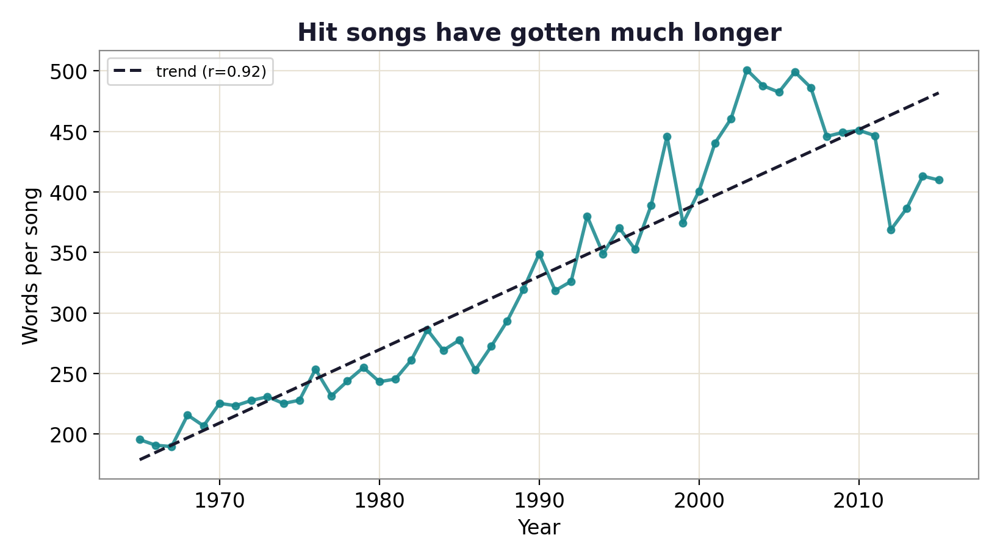

# Are song lyrics getting simpler?

A text analysis of 4,816 Billboard Year-End Hot 100 hits from 1965 to 2015, testing the claim that pop lyrics got simpler and more repetitive.

[Live site](https://lyhjeremy.github.io/lyrics-complexity-over-time/) · [Write-up](https://lyhjeremy.github.io/lyrics-complexity-over-time/overview/)

Design and copy follow [these standards](https://github.com/lyhjeremy/lyhjeremy/blob/main/DESIGN_STANDARDS.md).

## Results

Hit songs doubled in length and repeat more as whole documents. The vocabulary did not shrink.

| Measure | 1965–69 | 2010–15 | Change | r with year |
|---|---:|---:|---:|---:|
| Words per song | 200 | 413 | +107% | 0.92 |
| Compression ratio (lower = more repetitive) | 0.357 | 0.290 | −19% | −0.89 |
| Unique words in the first 100 | 57.5 | 61.4 | +7% | 0.58 |
| Characters per word | 3.84 | 3.83 | −0.3% | −0.46 |

Source: [`tables/trends.csv`](tables/trends.csv), written by `analyze.py`.



## Method

The lyrics in the dataset are lowercased with punctuation stripped, so there are no sentences and readability formulas such as Flesch-Kincaid can't be applied. Each song is scored on four measures that work on a bag of tokens:

- length: whitespace tokens per song
- lexical diversity: unique tokens among the first 100 (a length-controlled type-token ratio)
- repetition: zlib compression ratio over the whole lyric
- word length: mean characters per token

Songs are averaged by year, and each yearly series gets an ordinary least-squares trend against year (`scipy.stats.linregress`). The change column compares the 1965–69 and 2010–15 averages.

The compression measure is partly a length effect: a longer text gives zlib more history to match, so some of the repetition trend is the length trend measured a second way. The length-controlled diversity measure is the check on that.

## Limitations

- The Year-End Hot 100 is a sales ranking, so a shift in genre mix moves these lines without any change in how songs are written. Results are not split by genre.
- Yearly means rest on 86 to 100 songs each, so single years are noisy.
- Songs under 50 words are dropped.

## How to run

```bash
pip install -r requirements.txt
python fetch_data.py     # downloads the Billboard lyrics CSV to data/ (git-ignored)
python analyze.py        # writes figures/ and tables/
```

Stack: Python, pandas, NumPy, SciPy, matplotlib.

## Repo layout

| Path | What it is |
|---|---|
| `fetch_data.py` | Downloads the [walkerkq/musiclyrics](https://github.com/walkerkq/musiclyrics) CSV |
| `analyze.py` | Per-song metrics, yearly means, trend fits, figures |
| `tables/` | `by_year.csv` (yearly means and song counts), `trends.csv` (summary above) |
| `figures/` | The four trend charts |
| `writeup.md` | Short write-up |
| `index.html`, `overview/` | The published pages |

## License

[MIT](LICENSE) © 2026 Jeremy Lee
